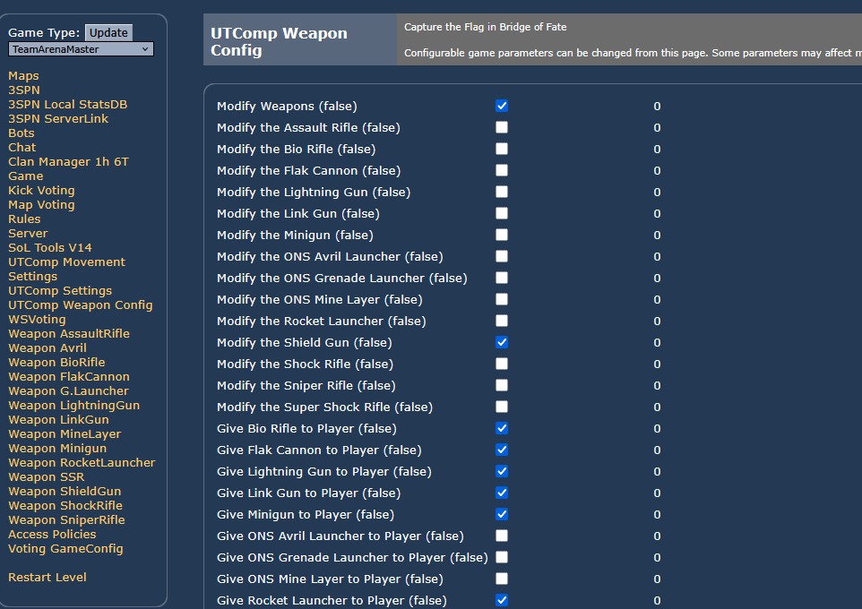
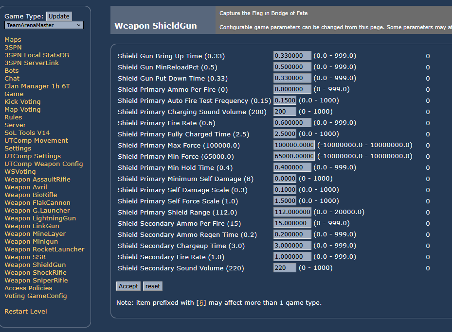

# WSUTComp Weapon Config

Mutator to allow you to modify all of the weapon parameters of each weapon, like fire rate, damage, etc. 
## Main Menu

The first item `Modify Weapons (false)` must be set `true` for any weapon property changes to take effect.  This is here so you can globally toggle on/off weapon config. In addition to the global toggle, each individual weapon config can be enabled.  Here I am enabling weapon config, and only for the shield gun.   

You can also cause the players to spawn with the weapon by checking the `Give <weapon> to Player` box, and adjust the ammo values. These options work even when `Modify Weapons` is off.  

For each configured weapon, there is a page to modify values

## Usage with WS3SPN / TAM

Because WS3SPN also does some weapon modifications, there are some caveats:

* If you use the give weapon feature to give a weapon already given by WS3SPN (e.g. shock), it is unknown which ammo value will take precidence (WS3SPN also configures ammo amounts).
* WS3SPN has an option to "modify the shield gun" which changes the shield jump.  WS3SPN's settings will override the ShieldGun config values SelfForceScale, SelfDamageScale, MinSelfDamage. WS3SPN also has these settings.   

 

## List of all Options
## General
The `Modify the <weapon>` toggles only apply while `Modify Weapons` is on. The give-weapon and ammo options work on their own, whether or not `Modify Weapons` is on.

* An ammo amount (`<weapon> Ammo Given`, `Assault Rifle Ammo`, `Assault Rifle Grenades`) is what every fresh copy of that weapon comes with, so it also applies to the weapon's map pickups and lockers, not just to the weapon given on spawn. These amounts take precedence over WSUTComp's `Number of grenades on spawn`.
* Weapon and ammo changes are undone on the server at the end of each map, so turning a weapon off (in the menu, with a `?ModifyX=False` URL option or in a map-vote game config) takes effect on the next map. Players who stay connected through the map change keep the old values for client-side prediction until they reconnect.
* A `Put Down Time` or `Bring Up Time` of 0 leaves the weapon's own time unchanged.
* `MinReloadPct` is the fraction of the refire time that has to pass after a shot before the weapon can be switched away (0 to 1).

| Property | Default Value |
|----------|---------------|
| Modify Weapons | false |
| Modify the Shield Gun | false |
| Modify the Assault Rifle | false |
| Modify the Bio Rifle | false |
| Modify the Shock Rifle | false |
| Modify the Link Gun | false |
| Modify the Minigun | false |
| Modify the Flak Cannon | false |
| Modify the Rocket Launcher | false |
| Modify the Lightning Gun | false |
| Modify the Sniper Rifle | false |
| Modify the Super Shock Rifle | false |
| Modify the ONS Grenade Launcher | false |
| Modify the ONS Avril Launcher | false |
| Modify the ONS Mine Layer | false |
| Give Bio Rifle to Player | false |
| Bio Rifle Ammo Given | 20 |
| Give Shock Rifle to Player | false |
| Shock Rifle Ammo Given | 20 |
| Give Link Gun to Player | false |
| Link Gun Ammo Given | 70 |
| Give Minigun to Player | false |
| Minigun Ammo Given | 150 |
| Give Flak Cannon to Player | false |
| Flak Cannon Ammo Given | 15 |
| Give Rocket Launcher to Player | false |
| Rocket Launcher Ammo Given | 12 |
| Give Lightning Gun to Player | false |
| Lightning Gun Ammo Given | 15 |
| Give Sniper Rifle to Player | false |
| Sniper Rifle Ammo Given | 15 |
| Give Super Shock Rifle to Player | false |
| Super Shock Rifle Ammo Given | 1 |
| Give ONS Grenade Launcher to Player | false |
| ONS Grenade Launcher Ammo Given | 10 |
| Give ONS Avril Launcher to Player | false |
| ONS Avril Launcher Ammo Given | 5 |
| Give ONS Mine Layer to Player | false |
| ONS Mine Layer Ammo Given | 4 |
| Give Dual Assault Rifle to Player | false |

 
 
 

## Shield Gun
`Shield Secondary Ammo Regen Time` is both how often the shield regains one point while lowered and how often it drains one point while raised. `Shield Secondary Chargeup Time` only ramps up the shield's glow. With WSUTComp's enhanced netcode on, WSUTComp sets the auto fire test frequency to 0.05 itself, which may override `Shield Primary Auto Fire Test Frequency`.

| Property | Default Value |
|----------|---------------|
| Shield Gun Put Down Time | 0.33 |
| Shield Gun Bring Up Time | 0.33 |
| Shield Gun MinReloadPct | 0.5 |
| Shield Primary Fire Rate | 0.6 |
| Shield Primary Ammo Per Fire | 0 |
| Shield Primary Shield Range | 112.0 |
| Shield Primary Min Hold Time | 0.4 |
| Shield Primary Min Force | 65000.0 |
| Shield Primary Max Force | 100000.0 |
| Shield Primary Min Damage | 40.0 |
| Shield Primary Max Damage | 150.0 |
| Shield Primary Self Force Scale | 1.0 |
| Shield Primary Self Damage Scale | 0.3 |
| Shield Primary Min Self Damage | 8.0 |
| Shield Primary Auto Fire Test Frequency | 0.15 |
| Shield Primary Fully Charged Time | 2.5 |
| Shield Primary Charging Sound Volume | 200 |
| Shield Secondary Fire Rate | 1.0 |
| Shield Secondary Ammo Per Fire | 15 |
| Shield Secondary Ammo Regen Time | 0.2 |
| Shield Secondary Chargeup Time | 3.0 |
| Shield Secondary Shield Sound Volume | 220 |

 
 
 

## Assault Rifle
`Assault Primary Spread` is the spread of the first shot after a 0.5s pause. While firing continuously, each shot adds 0.02 spread, up to 0.12; those numbers are hard-coded in the stock rifle, which UTComp and NewNet also use.

| Property | Default Value |
|----------|---------------|
| Assault Rifle Put Down Time | 0.33 |
| Assault Rifle Bring Up Time | 0.33 |
| Assault Rifle MinReloadPct | 0.5 |
| Assault Primary Trace Range | 10000.0 |
| Assault Primary Momentum | 0.0 |
| Assault Primary Ammo Per Fire | 1 |
| Assault Primary Damage Min | 7 |
| Assault Primary Damage Max | 7 |
| Assault Primary Fire Rate | 0.16 |
| Assault Primary Spread | 0.02 |
| Assault Secondary Damage Atten | 1.0 |
| Assault Secondary mHoldSpeedMin | 850.0 |
| Assault Secondary mHoldSpeedMax | 1600.0 |
| Assault Secondary mHoldSpeedGainPerSec | 750.0 |
| Assault Secondary mWaitTime | 0.5 |
| Assault Grenade Explode Timer | 2.0 |
| Assault Grenade Dampen Factor | 0.5 |
| Assault Grenade Dampen Factor Parallel | 0.8 |
| Assault Grenade Damage | 70.0 |
| Assault Grenade Damage Radius | 220.0 |
| Assault Grenade Momentum Transfer | 75000.0 |
| Modify the Assault Rifle Ammo | false |
| Assault Rifle Ammo | 100 |
| Assault Rifle Grenades | 4 |

 
 
 

## Bio Rifle
| Property | Default Value |
|----------|---------------|
| Bio Rifle Put Down Time | 0.33 |
| Bio Rifle Bring Up Time | 0.33 |
| Bio Rifle MinReloadPct | 0.5 |
| Bio Primary Fire Rate | 0.33 |
| Bio Primary Ammo Per Fire | 1 |
| Bio Secondary Fire Rate | 0.33 |
| Bio Secondary Goop Up Rate | 0.25 |
| Bio Secondary Max Goop Load | 10 |
| Bio Projectile Base Damage | 20 |
| Bio Projectile Globling Speed | 200.0 |
| Bio Projectile Rest Time | 2.25 |
| Bio Projectile Touch Detonation Delay | 0.15 |
| Bio Projectile Drip Time | 1.8 |
| Bio Projectile Max Goop Level | 5 |
| Bio Projectile Merge Globs | true |

 
 
 

## Shock Rifle
| Property | Default Value |
|----------|---------------|
| Shock Rifle Put Down Time | 0.33 |
| Shock Rifle Bring Up Time | 0.33 |
| Shock Rifle MinReloadPct | 0.5 |
| Shock Primary Trace Range | 17000.0 |
| Shock Primary Momentum | 60000.0 |
| Shock Primary Ammo Per Fire | 1 |
| Shock Primary Damage Min | 45 |
| Shock Primary Damage Max | 45 |
| Shock Primary Fire Rate | 0.7 |
| Shock Secondary Ammo Per Fire | 1 |
| Shock Secondary Fire Rate | 0.6 |
| Shock Secondary Projectile Speed | 1150.0 |
| Shock Secondary Projectile Max Speed | 1150.0 |
| Shock Secondary Damage | 45.0 |
| Shock Secondary Damage Radius | 150.0 |
| Shock Secondary Momentum Transfer | 70000.0 |
| Shock Combo Damage | 200.0 |
| Shock Combo Damage Radius | 275.0 |
| Shock Combo Momentum Transfer | 150000.0 |
| Shock Secondary Projectile Lifespan | 10.0 |
| Shock Combo Ammo Cost | 3 |
| Shock Projectile Force Scale | 5.0 |
| Shock Projectile Force Radius | 40.0 |
| Shock Projectile Sound Radius | 100.0 |
| Shock Projectile Sound Volume | 50 |

 
 
 

## Link Gun
Link bolts never do splash damage: `Link Projectile Damage Radius` only damages the driver when a bolt hits a vehicle.

| Property | Default Value |
|----------|---------------|
| Link Primary Ammo Per Fire | 2 |
| Link Primary Fire Rate | 0.2 |
| Link Projectile Damage | 30 |
| Link Projectile Damage Radius | 0.0 |
| Link Projectile Speed | 1000.0 |
| Link Projectile Max Speed | 4000.0 |
| Link Projectile Momentum Transfer | 0.0 |
| Link Projectile Life Span | 3.0 |
| Link Projectile Cull Distance | 3500.0 |
| Link Secondary Trace Range | 1100.0 |
| Link Secondary Momentum Transfer | 2000.0 |
| Link Secondary Ammo Per Fire | 1 |
| Link Secondary Damage | 9 |
| Link Secondary Fire Rate | 0.12 |
| Link Secondary Link Flexibility | 0.64 |
| Link Secondary Link Break Delay | 0.5 |
| Link Gun Put Down Time | 0.33 |
| Link Gun Bring Up Time | 0.33 |
| Link Gun MinReloadPct | 0.5 |

 
 
 

## Minigun
| Property | Default Value |
|----------|---------------|
| Minigun Put Down Time | 0.33 |
| Minigun Bring Up Time | 0.33 |
| Minigun MinReloadPct | 0.5 |
| Minigun Primary Damage Min | 7 |
| Minigun Primary Damage Max | 8 |
| Minigun Primary Trace Range | 10000.0 |
| Minigun Primary Momentum | 0.0 |
| Minigun Primary Ammo Per Fire | 1 |
| Minigun Primary Rounds Per Rotation | 5 |
| Minigun Primary Barrel Rotations Per Sec | 3.0 |
| Minigun Primary Spread | 0.08 |
| Minigun Primary Pre Fire Time | 0.27 |
| Minigun Primary Windup Time | 0.27 |
| Minigun Secondary Damage Min | 14 |
| Minigun Secondary Damage Max | 16 |
| Minigun Secondary Trace Range | 10000.0 |
| Minigun Secondary Momentum | 0.0 |
| Minigun Secondary Ammo Per Fire | 1 |
| Minigun Secondary Rounds Per Rotation | 5 |
| Minigun Secondary Barrel Rotations Per Sec | 1.0 |
| Minigun Secondary Spread | 0.03 |
| Minigun Secondary Pre Fire Time | 0.15 |
| Minigun Secondary Windup Time | 0.15 |

 
 
 

## Flak Cannon
`Flak Chunk Damage Atten Per Second` is how much damage a chunk loses for each second it has been flying. `Flak Shell Damage Radius` is honored by the UTComp and NewNet shells; the stock Flak Cannon (UTComp weapon stats and NewNet both off) always uses a 220 radius. With `Flak Chunk Bounce` off, a chunk still ricochets off the first surface it hits (each chunk rolls 0 to 2 bounces), then stops on the next floor it touches.

| Property | Default Value |
|----------|---------------|
| Flak Primary Ammo Per Fire | 1 |
| Flak Primary Fire Rate | 0.8947 |
| Flak Primary Projectiles Per Fire | 9 |
| Flak Primary Spread | 1400 |
| Flak Primary Spread Style | Random |
| Flak Chunk Damage Atten Per Second | 5.0 |
| Flak Chunk Speed | 2500 |
| Flak Chunk Max Speed | 2700 |
| Flak Chunk Damage | 13.0 |
| Flak Chunk Momentum Transfer | 10000.0 |
| Flak Chunk Cull Distance | 3000.0 |
| Flak Chunk Life Span | 2.7 |
| Flak Chunk Bounce | true |
| Flak Secondary Ammo Per Fire | 1 |
| Flak Secondary Fire Rate | 1.11 |
| Flak Secondary Projectiles Per Fire | 1 |
| Flak Secondary Spread | 0 |
| Flak Shell Toss Z | 225.0 |
| Flak Shell Speed | 1200.0 |
| Flak Shell Max Speed | 2000.0 |
| Flak Shell Damage | 90.0 |
| Flak Shell Damage Radius | 220.0 |
| Flak Shell Momentum Transfer | 75000.0 |
| Flak Shell Cull Distance | 4000.0 |
| Flak Shell Life Span | 6.0 |
| Flak Cannon Put Down Time | 0.33 |
| Flak Cannon Bring Up Time | 0.33 |
| Flak Cannon MinReloadPct | 0.5 |

 
 
 

## Rocket Launcher
Lock-on (seeking) rockets live 1.25x `Rocket Projectile Lifespan`, matching stock (10s against 8s). So does every rocket from the UTComp weapon-stats launcher, which fires seeking-type rockets only. Alt fire loads its second rocket after `Rocket Secondary Fire Rate` and its third after twice that, so keep `Rocket Secondary Max Hold Time` above 2x the fire rate or the third rocket never loads.

| Property | Default Value |
|----------|---------------|
| Rocket Launcher Put Down Time | 0.33 |
| Rocket Launcher Bring Up Time | 0.33 |
| Rocket Launcher MinReloadPct | 0.5 |
| Rocket Launcher Seek Check Freq | 0.5 |
| Rocket Launcher Seek Range | 8000.0 |
| Rocket Launcher Lock Required Time | 1.25 |
| Rocket Launcher Unlock Required Time | 0.5 |
| Rocket Launcher Lock Aim | 0.996 |
| Rocket Primary Fire Rate | 0.9 |
| Rocket Primary Ammo Per Fire | 1 |
| Rocket Secondary Fire Rate | 0.95 |
| Rocket Secondary Ammo Per Fire | 1 |
| Rocket Secondary Tight Spread | 300.0 |
| Rocket Secondary Loose Spread | 1000.0 |
| Rocket Secondary Max Hold Time | 2.3 |
| Rocket Projectile Speed | 1350.0 |
| Rocket Projectile Max Speed | 1350.0 |
| Rocket Projectile Damage | 90.0 |
| Rocket Projectile Damage Radius | 220.0 |
| Rocket Projectile Momentum Transfer | 50000.0 |
| Rocket Projectile Lifespan | 8.0 |
| Rocket Projectile Flock Radius | 12.0 |
| Rocket Projectile Flock Stiffness | -40.0 |
| Rocket Projectile Flock Max Force | 600.0 |
| Rocket Projectile Flock Curl Force | 450.0 |

 
 
 

## Lightning Gun
| Property | Default Value |
|----------|---------------|
| Lightning Gun Put Down Time | 0.33 |
| Lightning Gun Bring Up Time | 0.36 |
| Lightning Gun MinReloadPct | 0.25 |
| Lightning Gun Ammo Per Fire | 1 |
| Lightning Gun Damage Min | 70 |
| Lightning Gun Damage Max | 70 |
| Lightning Gun Trace Range | 17000.0 |
| Lightning Gun Fire Rate | 1.6 |
| Lightning Gun Num Arcs | 3 |
| Lightning Gun Arc Damage Multiplier | 0.5 |
| Lightning Gun Arc Trace Distance | 300.0 |
| Lightning Gun Headshot Multiplier | 2.0 |

 
 
 

## Sniper Rifle
| Property | Default Value |
|----------|---------------|
| Sniper Rifle Put Down Time | 0.58 |
| Sniper Rifle Bring Up Time | 0.6 |
| Sniper Rifle MinReloadPct | 0.5 |
| Sniper Rifle Ammo Per Fire | 1 |
| Sniper Rifle Damage | 60 |
| Sniper Rifle Trace Range | 17000.0 |
| Sniper Rifle Fire Rate | 1.33 |
| Sniper Rifle Headshot Multiplier | 2.0 |

 
 
 

## Super Shock Rifle
These settings also apply to the zoom InstaGib rifle.

| Property | Default Value |
|----------|---------------|
| Super Shock Rifle Put Down Time | 0.33 |
| Super Shock Rifle Bring Up Time | 0.33 |
| Super Shock Rifle MinReloadPct | 0.5 |
| Super Shock Primary Trace Range | 17000.0 |
| Super Shock Primary Momentum | 100000.0 |
| Super Shock Primary Ammo Per Fire | 0 |
| Super Shock Primary Damage Min | 1000 |
| Super Shock Primary Damage Max | 1000 |
| Super Shock Primary Fire Rate | 1.1 |

 
 
 

## Grenade Launcher
A `Life Span` of 0 means grenades stay until detonated.

| Property | Default Value |
|----------|---------------|
| ONS Grenade Launcher Put Down Time | 0.33 |
| ONS Grenade Launcher Bring Up Time | 0.33 |
| ONS Grenade Launcher MinReloadPct | 0.5 |
| ONS Grenade Primary Fire Rate | 0.65 |
| ONS Grenade Primary Ammo Per Fire | 1 |
| ONS Grenade Bounce | true |
| ONS Grenade Speed | 1200.0 |
| ONS Grenade Max Speed | 1200.0 |
| ONS Grenade Damage | 100.0 |
| ONS Grenade Damage Radius | 175.0 |
| ONS Grenade Momentum Transfer | 50000.0 |
| ONS Grenade Cull Distance | 5000.0 |
| ONS Grenade Life Span | 0.0 |
| ONS Grenade Dampen Factor | 0.5 |
| ONS Grenade Dampen Factor Parallel | 0.8 |

 
 
 

## Avril
| Property | Default Value |
|----------|---------------|
| ONS Avril Launcher Lock Check Freq | 0.2 |
| ONS Avril Launcher Max Lock Range | 15000.0 |
| ONS Avril Launcher Lock Aim | 0.996 |
| ONS Avril Launcher Put Down Time | 0.33 |
| ONS Avril Launcher Bring Up Time | 0.45 |
| ONS Avril Launcher MinReloadPct | 0.0 |
| ONS Avril Primary Ammo Per Fire | 1 |
| ONS Avril Primary Fire Rate | 4.0 |
| ONS Avril Primary Kick Momentum | X=-350.0,Z=175.0 |
| ONS Avril Lead Target Delay | 1.0 |
| ONS Avril Projectile Target | true |
| ONS Avril Speed | 550.0 |
| ONS Avril Max Speed | 2800.0 |
| ONS Avril Damage | 125.0 |
| ONS Avril Damage Radius | 150.0 |
| ONS Avril Momentum Transfer | 50000.0 |
| ONS Avril Life Span | 7.0 |

 
 
 

## Mine Layer
| Property | Default Value |
|----------|---------------|
| ONS Mine Layer Reload Delay | 0.4 |
| ONS Mine Layer Max Mines | 8 |
| ONS Mine Layer Put Down Time | 0.40 |
| ONS Mine Layer Bring Up Time | 0.35 |
| ONS Mine Layer MinReloadPct | 0.5 |
| ONS Mine Layer Ammo Per Fire | 1 |
| ONS Mine Layer Fire Rate | 1.1 |
| ONS Mine Detection Timer | 0.5 |
| ONS Mine Scurry Speed | 525.0 |
| ONS Mine Scurry Anim Rate | 4.1 |
| ONS Mine Target Loc Fuzz | 250 |
| ONS Mine Bounce | true |
| ONS Mine Speed | 800.0 |
| ONS Mine Max Speed | 800.0 |
| ONS Mine Damage | 95.0 |
| ONS Mine Damage Radius | 250.0 |
| ONS Mine Momentum Transfer | 50000.0 |
| ONS Mine Cull Distance | 6000.0 |

 
 
 
